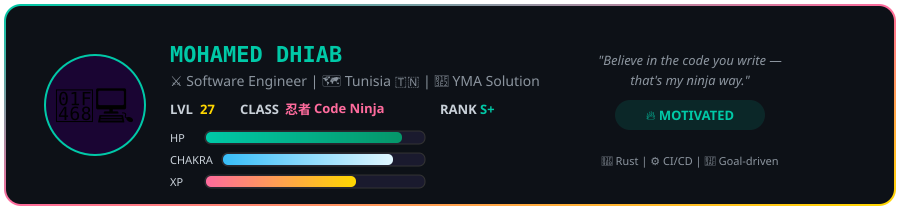
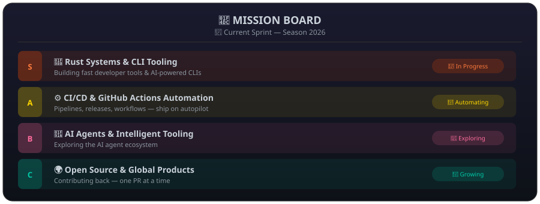

  

## ⚡ About Me

<table align="center">
  <tr>
    <td width="55%" valign="top">
      <ul>
        <li>🧑‍💻 <b>Software Engineer</b> at <b>YMA Solution</b></li>
        <li>🌍 Based in <b>Tunisia</b> 🇹🇳 — building for global markets</li>
        <li>🦀 Writing <b>Rust</b> CLIs &amp; developer tooling</li>
        <li>⚙️ Automating everything with <b>GitHub Actions</b></li>
        <li>🤖 Exploring the <b>AI agent</b> ecosystem</li>
        <li>⚽ Football &amp; 🎌 Anime fan — <i>dattebayo!</i></li>
        <li>💬 Ask me about <b>Rust, TypeScript, NestJS, CI/CD</b></li>
        <li>📫 <a href="mailto:contact@mohameddhiab.com"><b>contact@mohameddhiab.com</b></a></li>
      </ul>
    </td>
    <td width="45%" align="center">
      
    </td>
  </tr>
</table>

  

## 🌐 Connect With Me

&nbsp;

&nbsp;

&nbsp;

## ⚽ Tech Stack — 4-3-3 Formation

  

## 📊 GitHub Analytics

&nbsp;

&nbsp;

  

 

 

## 📜 Mission Board — Active Quests

  

## 🏆 Achievements

  

## 🐉 Contribution Activity — Path of the Ninja

<picture>
  <source media="(prefers-color-scheme: dark)" srcset="https://raw.githubusercontent.com/Mohameddhiab/Mohameddhiab/output/github-contribution-grid-snake-dark.svg" />
  <source media="(prefers-color-scheme: light)" srcset="https://raw.githubusercontent.com/Mohameddhiab/Mohameddhiab/output/github-contribution-grid-snake.svg" />
  
</picture>

⚡ Every commit is chakra gathered on the journey — keep training, keep shipping.

> The snake is generated by the workflow in [`.github/workflows/snake.yml`](.github/workflows/snake.yml) (daily + manual run).

✨ **Random Dev Quote**

 

🚀 **Always shipping — code, creativity, and passion** · ✨ Mohamed Dhiab — 2026

